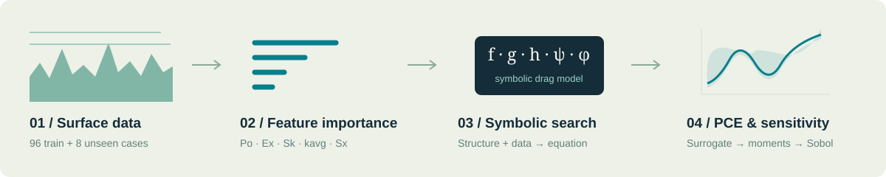
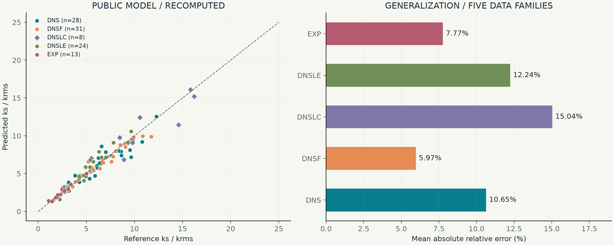
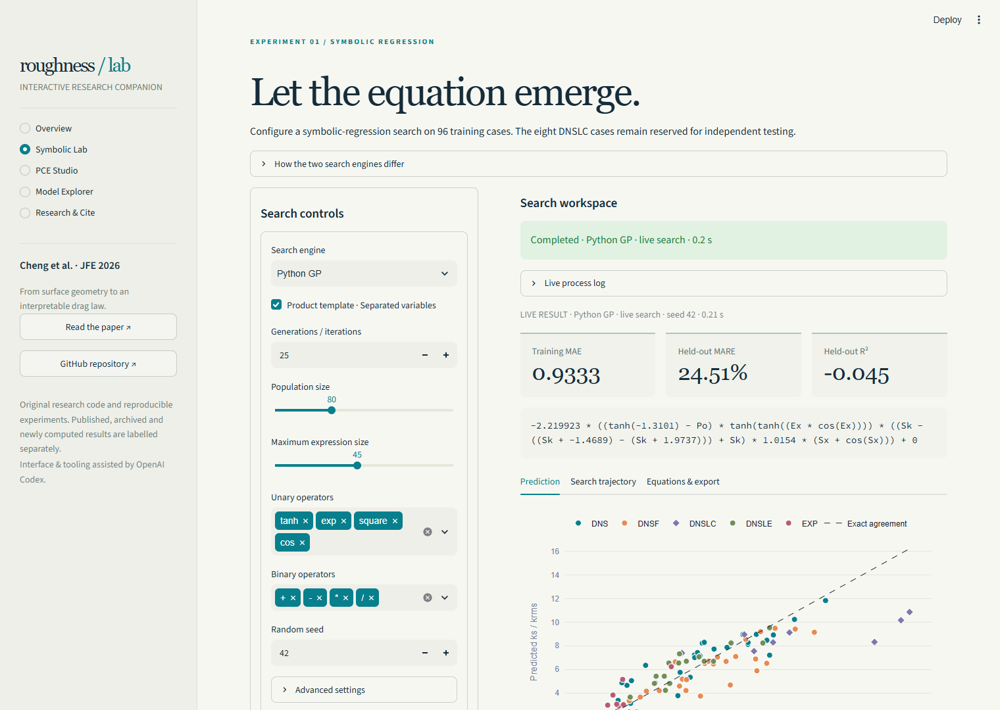
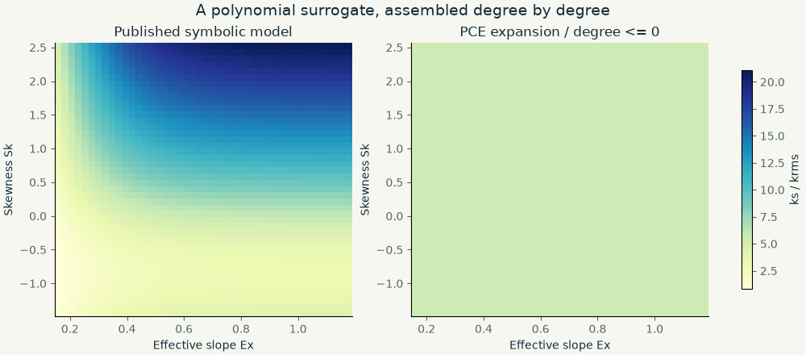
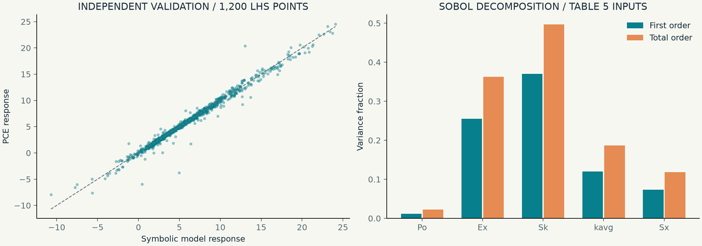

<div align="center">


**An interactive research companion for feature importance-informed symbolic drag modelling.**

[](https://doi.org/10.1115/1.4070838)
[](https://doi.org/10.1016/j.jcp.2026.115311)
[](#run-the-interactive-lab)
[](LICENSE)

[Research](#the-research) · [Results](#results-you-can-inspect) · [Interactive lab](#run-the-interactive-lab) · [PCE](#polynomial-chaos-in-motion) · [Cite](#citation) · [Local guide](docs/LOCAL_DEMO.md)

</div>

## The research

Predicting drag across diverse rough surfaces calls for a model that is both accurate and readable. This work selects influential geometric features, learns a structured analytical expression for equivalent sandgrain roughness, and uses polynomial chaos expansion (PCE) to interpret the model's sensitivity.

**Ao Cheng, Zhideng Zhou, Xiaolei Yang and Guowei He**  
*A Drag Model for Rough Surfaces Learned Using Feature Importance-Informed Symbolic Regression*  
**Journal of Fluids Engineering 148(4), 041302 (April 2026).** [Read the article ↗](https://doi.org/10.1115/1.4070838)

| Training surfaces | Unseen test surfaces | Overall mean relative error | Overall maximum relative error |
|:---:|:---:|:---:|:---:|
| **96** | **8** | **9.60%** | **30.79%** |

These are the paper's results across the 104 supplied cases, rather than performance claims for a short interactive search. The public expression and CSV reproduce 9.5979% mean and 30.7924% maximum absolute relative error.



Five geometric inputs form a product of univariate subfunctions:

$$
\frac{k_s}{k_{\mathrm{rms}}}=h(P_o)\,g(E_x)\,f(S_k)\,\psi(k_{\mathrm{avg}})\,\phi(S_x).
$$

The multiplicative template makes each feature's contribution available for inspection. See the article's Sections 4.4–4.5 and Appendix C for sensitivity analysis and the mathematical PCE formulation.

## Results you can inspect



**Recomputed from the repository data.** Each point uses the public analytical expression; DNSLC diamonds are the eight held-out cases. The second panel shows errors within each data family. These figures were newly drawn from code and data, with a layout distinct from the paper. No paper figures were cropped or copied.

The lab also includes the two archived symbolic-search fronts in `results/csvFiles/`. Archived results are labelled separately from newly executed searches.

## Run the interactive lab

```bash
python -m venv .venv
# Windows PowerShell
.venv\Scripts\Activate.ps1
# macOS / Linux: source .venv/bin/activate
python -m pip install -r requirements.txt
python -m streamlit run streamlit_app.py --server.port 8507
```

Open **[http://localhost:8507](http://localhost:8507)**. On Windows, the one-command launcher handles environment creation and installation:

```powershell
.\start_streamlit.ps1
```

| Workspace | What you can do |
|:---|:---|
| **Overview** | Explore an interactive 3D response surface and recomputed predictions across five datasets. |
| **Symbolic Lab** | Set operators, seed, iteration count, population size and complexity; run an actual search; inspect logs, equations, training metrics and held-out predictions. |
| **PCE Studio** | Edit independent uniform/normal input distributions, polynomial degree and LHS size; fit the original `PolyChaos`; play the expansion animation; inspect Sobol indices and independent validation. |
| **Model Explorer** | Adjust all five features; inspect response surfaces, individual factors and source data. |
| **Research & Cite** | Copy verified BibTeX, open the companion paper, and inspect provenance notes. |



The original PySR backend was also executed through the page. Its [saved run](docs/runs/pysr_seed42.json), [process log](docs/runs/pysr_process.txt), and [result screenshot](assets/screenshots/10-pysr-result.png) are included. Select **View verified PySR demo** in a fresh lab session to inspect it without another search. It is clearly labelled as a saved experiment.

### Symbolic regression backends

**Python GP** is an included lightweight genetic-programming engine for immediate exploration without Julia. It performs a new search using the same inputs and operator family, with optional separated-variable product structure. Numerical protections are applied to division, exponentials, squares and products. This engine is explicitly distinct from the paper's PySR implementation.

**PySR** adapts the original `results/SR_train.py` and preserves the five-factor expression template, float64 precision and L1 objective. Install its additional dependencies:

```bash
python -m pip install -r requirements-pysr.txt
```

Then select **PySR** in the lab. The first launch installs or locates Julia and initializes SymbolicRegression.jl. Initialization is recorded in the live log. Search runs in a separate process and can be cancelled. See [the local guide](docs/LOCAL_DEMO.md) for first-run setup and troubleshooting.

The paper configuration uses **1500 iterations, 90 populations, population size 80, 1200 cycles per iteration and maximum size 60**. The interactive defaults use smaller budgets. A short run is an illustration of the search process, not a reproduction of the published optimum.

## Polynomial chaos in motion



**Actual computed expansion.** The left panel shows a slice of the symbolic drag model; the right panel progressively retains higher-degree terms from one fitted PCE. Fixed inputs are Po=0.634, kavg=0.067 and Sx=0.159. This is an animation of polynomial approximation, not a time-resolved fluid simulation.



The above PCE experiment uses the paper's **Table 5 mixed distributions**, **degree 6**, **462 basis terms**, **2500 LHS fitting samples**, and **seed 42**. Validation uses **1200 independently sampled LHS points**, so it also probes distribution tails beyond the empirical feature bounds. It is a new diagnostic run; the paper's validation plot uses different evaluation points. The precise settings and numerical results are saved in [verification-results.json](docs/verification-results.json).

The app supports both this paper preset and a bounded uniform preset, plus an **Ishigami benchmark** for checking sensitivity-index convergence. The calculations call the existing `code_files/pce_core.py` implementation. All Sobol indices assume independent input distributions.

Helpful examples: [UQpy PCE gallery](https://uqpyproject.readthedocs.io/en/latest/auto_examples/surrogates/pce/) · [Chaospy polynomial introduction](https://chaospy.readthedocs.io/en/master/user_guide/polynomial/introduction.html). These are learning references; the lab's figures and animations are original.

## Repository guide

```text
streamlit_app.py                 Interactive research companion
roughlab/                       Data/model adapters, charts, PCE and SR workers
code_files/                     Original PCE research implementation
  pce_core.py                   PolyChaos: LHS, least squares, moments, Sobol
  pce_utils.py                  Polynomial / quadrature utilities
  run_analysis.py               Original user model and execution example
results/
  SR_train.py                   Original PySR training configuration
  csvFiles/                     104 roughness cases and archived search fronts
  subFunc_plot.ipynb             Original factor / interaction notebook
  loss_plot.ipynb                Original search-front notebook
assets/                         Original redrawings, animation and app screenshots
docs/                           Local guide, verification and citation sources
tools/build_assets.py           Rebuild showcase figures from code and data
tests/                          Numerical and application verification
CITATION.bib / CITATION.cff      Verified article metadata
requirements*.txt               Base dependencies and optional PySR backend
start_streamlit.ps1              Windows launcher
```

Original research scripts remain available. The app adds a presentation and experiment layer, including explicit feature ordering and continuous limits at Sk=0 and kavg=0.

## Related work

**[A physics-embedded symbolic wall model for large-eddy simulation of separated flows](https://doi.org/10.1016/j.jcp.2026.115311)**  
Ao Cheng, Xin-Lei Zhang, Zhideng Zhou, Xiaolei Yang and Guowei He.  
*Journal of Computational Physics* **567**, 115311 (2026).

A companion study on interpretable wall modelling for separated-flow LES. Its article record is linked here for context; its solver and training pipeline are not included in this repository.

## Citation

Metadata checked against publisher-deposited Crossref records on **2026-10-13**, with the JFE PDF and JCP publisher page used as cross-checks. The JFE article identifier is **041302**, replacing the early README's provisional `pages={1-44}`. The print issue is **April 2026**; the article appeared online on February 5, 2026. See [citation verification](docs/CITATION_VERIFICATION.md).

```bibtex
@article{cheng2026drag,
  title   = {A Drag Model for Rough Surfaces Learned Using Feature Importance-Informed Symbolic Regression},
  author  = {Cheng, Ao and Zhou, Zhideng and Yang, Xiaolei and He, Guowei},
  journal = {Journal of Fluids Engineering},
  volume  = {148},
  number  = {4},
  pages   = {041302},
  year    = {2026},
  month   = apr,
  doi     = {10.1115/1.4070838},
  url     = {https://doi.org/10.1115/1.4070838}
}
```

Both articles' entries are available in [CITATION.bib](CITATION.bib). GitHub's citation interface is supported by [CITATION.cff](CITATION.cff).

## Contributors & acknowledgments

Research, original code and scientific interpretation: **Ao Cheng and coauthors**.

**OpenAI Codex** assisted with the Streamlit interface, code integration, original redrawings, documentation and verification. This acknowledgment describes software assistance and does not assign research authorship.

Released under the [MIT License](LICENSE).
